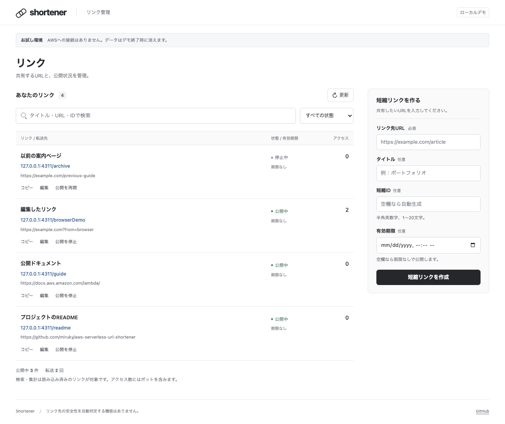

# AWS Serverless URL Shortener

**自分のAWSに配置できる、認証付きのURL短縮・リンク管理。**

URLを短くするだけでなく、タイトル、有効期限、転送先、公開状態を一つの画面から管理できます。
招待した管理者だけが操作し、共有した短縮リンクはログインなしで開けます。



一覧の中で転送先・公開状態・期限を確認し、その場でコピーや編集ができます。スマホでは「新規リンク」から作成欄へ移動します。

## まず動かす

Node.js 24.19.0、Python 3.12.13、uv 0.11.20、Gitを用意します。macOSとLinuxを対象にしています。

```sh
git clone https://github.com/miruky/aws-serverless-url-shortener.git
cd aws-serverless-url-shortener
./dev setup
./dev serve
```

[ローカルの管理画面](http://127.0.0.1:4310/app/)を開いて、URLを作成してください。
**AWSアカウントや認証情報は不要です。** Motoを使うデモで、データはプロセス終了時に消えます。
本番のデータをローカルへ複製したり、既存AWS環境に接続したりしません。

`setup` はロック済みの依存関係、検査ツール、リポジトリ内のGitフックを導入します。
初めてブラウザ検査を行うときは `npx playwright install chromium` も実行してください。

## GitHubだけで動く？

**現在の構成を公開運用するにはAWSが必要です。** GitHubはソース管理・配布とCIを担当します。

| 環境 | 用途 | AWS |
| --- | --- | --- |
| 手元のPC | Motoによる動作確認。終了時にデータが消える | 不要 |
| GitHub | ソース・README・自動テスト | 不要 |
| 公開サービス | API Gateway/Lambdaで処理、DynamoDBで保存、Cognitoでログイン | 必要 |

[GitHub Pagesは静的サイトの配信](https://docs.github.com/en/pages/getting-started-with-github-pages/what-is-github-pages)です。
現在のLambda処理・DB・認証をそのまま動かす場所にはなりません。
あらかじめ登録したURLへの静的転送だけなら別構成で実現できますが、現在の管理画面やリアルタイム更新・アクセス集計までGitHubだけで提供する構成ではありません。

## できること

- 自動生成または任意の英数字IDで短縮リンクを作成
- タイトル・有効期限・転送先の編集
- 公開の停止と再開。使用済みIDの再割当てはしない
- 一覧の継続読込、読み込んだ範囲の検索・状態別表示、リンクのコピー
- 期限・停止を反映する302リダイレクトと、アクセス数を増やさないHEAD
- 更新時のバージョン確認による、別の操作との上書き競合の検出
- Cognitoの招待制ログイン、TOTPによるMFA、管理APIの認証

対象は**一人または一つのチームが共有する管理領域**です。一般ユーザーのセルフ登録や、利用者ごとのテナント分離は提供しません。
アクセス数は転送を処理した回数で、ボットや再試行を含みます。訪問者数や成果数を示す値ではありません。

## 検証状況

[検証記録](docs/operations/verification.md)に、実行した検査とその範囲を記載しています。
ローカルのAPI・DynamoDBモック・ブラウザ操作・文書グラフ・テンプレート・配布ZIPを検査します。
**実AWSへの配置、Cognitoでの実ログイン、負荷・復旧演習は別の受入検証です。**

機能や検査の追加だけで「本番対応済み」とは扱いません。[改善台帳](docs/product/improvements.md)では、実装済みと今後の候補を分けています。

## 開発とドキュメント

```sh
./dev test                  # AWSへのネットワーク接続を禁止したPythonテスト
./dev docs                  # 要件・設計・実装・テストをノードで表示
./dev trace impact          # どの文書の再確認が必要か
./dev check                 # CIと同じ品質検査とパッケージ生成
```

[仕様のワークベンチ](http://127.0.0.1:4323/)には、文書、実装、設定、テストの関係が表示されます。
コードの変更は関連文書の再確認へ伝播します。文書の更新、または変更不要と判断した具体的な理由がない状態では検査を通しません。
要件・設計・テストの参照切れ、未管理ファイル、古い検証記録も確認します。

Red/Greenの実行記録にはテストと対象ファイルのハッシュを残します。元のコミットに現在のテストを当てる再現実行も可能です。
手順は[開発ガイド](docs/engineering/workflow.md)、貢献時の入口は[CONTRIBUTING](CONTRIBUTING.md)を参照してください。

Gitフックは手元のミスを検出する補助です。GitHub側でも必須チェックにするには、公開後に `quality` をブランチルールへ登録してください。
仕組みが検出するのは変更と証拠の整合性です。文書の意味の正しさまで自動で保証するものではありません。

## API

| メソッド | パス | 用途 | 認証 |
| --- | --- | --- | --- |
| POST | `/urls` | 作成 | 必須 |
| GET | `/urls?limit=50&cursor=...` | 停止済みを含む一覧 | 必須 |
| GET | `/urls/{short_id}` | 詳細・アクセス数 | 必須 |
| PATCH | `/urls/{short_id}` | 編集・停止・再開 | 必須 |
| DELETE | `/urls/{short_id}` | 公開停止 | 必須 |
| GET / HEAD | `/{short_id}` | 転送 | 不要 |
| GET | `/app/` | 管理画面 | 画面のみ公開、操作は認証必須 |

```json
{
  "url": "https://example.com/article?from=newsletter",
  "title": "新しい記事",
  "custom_alias": "article",
  "expires_at": null
}
```

作成成功は201、使用済みIDは409です。編集には取得時の `version` を指定します。
[API契約とエラー](docs/reference/api.md)に、入力の上限、国際化URL、ページング、互換性の変更をまとめています。

## AWSへの配置

```sh
./dev check
./dev prepare --region ap-northeast-1
```

ここまではローカル処理で、AWSリソースを作成しません。テスト済みZIP、API変更を反映するテンプレート、生成した物理名とパラメータを用意します。
実際の配置は[デプロイ手順](docs/operations/deployment.md)に従い、変更セットを確認してから行います。

新版の入口は `infrastructure/product.yaml` と `infrastructure/artifacts.yaml` です。
旧 `template.yaml`・`pipeline.yaml` は以前の構成の参照資料として残しています。**既存環境は[移行手順](docs/operations/migration.md)を先に確認してください。旧パイプラインを新版へそのまま接続しないでください。**

独自ドメイン、詳細な日別分析、QRコード、CSV入出力、一般公開時の通報・悪用対策は[今後の候補](docs/product/improvements.md)です。
AWS利用料金は発生し得ます。APIのスロットリングは予算の上限を保証しません。

## 構成

PythonのLambda関数、API Gateway REST API、DynamoDB、Cognitoを使います。
ブラウザ画面も同じAPIの配下から配信し、管理APIへはCognitoのIDトークンを送ります。署名検証はAPI Gatewayが行います。

- `src/`: ハンドラー、入力検査、データ層、ローカルデモ
- `web/`: ビルド不要の管理画面。外部CDNや外部フォントを使わない
- `infrastructure/`: 新版の設定、検査規則、旧構成の参照資料
- `tests/`: Python、ハーネス、ブラウザの検査
- `docs/`: 要件・設計・API・運用・改善台帳
- `tools/`: 開発入口、文書グラフ、TDD記録、配布物の作成

安全性の境界とデータ保存の方針は[セキュリティとプライバシー](docs/operations/security.md)、問題報告は[SECURITY](SECURITY.md)を参照してください。

## ライセンス

[MIT](LICENSE)。同梱・利用する外部ソフトウェアについては[出典とライセンス](docs/engineering/provenance.md)を参照してください。
